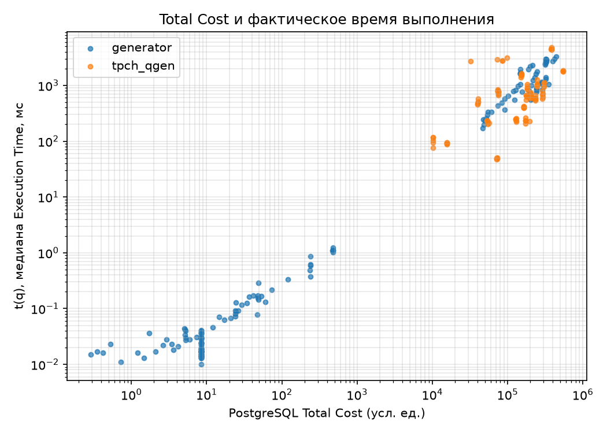

# Этап 2. Признаки PostgreSQL EXPLAIN, методы оценки стоимости и baseline Total Cost

## 1. Что даёт EXPLAIN до выполнения запроса

`EXPLAIN (FORMAT JSON)` возвращает дерево плана, выбранного оптимизатором. Запрос при этом не выполняется. В каждом узле есть оценки оптимизатора:

| Поле узла | Смысл | Доступно до выполнения |
|---|---|---|
| `Node Type` | тип операции: Seq Scan, Index Scan, Hash Join, Sort, Aggregate, WindowAgg... | да |
| `Startup Cost` | оценка стоимости до выдачи первой строки, усл. ед. | да |
| `Total Cost` | оценка полной стоимости узла с учётом поддерева, усл. ед. | да |
| `Plan Rows` | оценка числа строк на выходе узла | да |
| `Plan Width` | оценка средней ширины строки, байт | да |
| `Relation Name`, `Index Name`, `Join Type`, `Strategy`, `Sort Key`, `Filter` | структура и параметры операции | да |
| `Actual Startup Time`, `Actual Total Time` | фактическое время узла | нет, только ANALYZE |
| `Actual Rows`, `Actual Loops`, `Rows Removed by Filter` | фактические кардинальности | нет, только ANALYZE |
| `Shared Hit/Read Blocks`, `Sort Method`, `Peak Memory Usage`, `Hash Batches` | фактическое использование буферов и памяти | нет, только ANALYZE / BUFFERS |
| `Execution Time`, `Planning Time` | фактическое время выполнения и планирования | нет, только ANALYZE |

Стоимость в PostgreSQL выражена в условных единицах: чтение одной страницы при последовательном доступе = `seq_page_cost` = 1.0. Стоимость узла складывается из страничных составляющих (`seq_page_cost`, `random_page_cost`) и процессорных (`cpu_tuple_cost`, `cpu_index_tuple_cost`, `cpu_operator_cost`), умноженных на *оценённое* число страниц и строк [1, 2]. Отсюда три известные причины расхождения Total Cost с фактическим временем:

1. Коэффициенты по умолчанию не откалиброваны под конкретное оборудование: стоимость задаётся в условной шкале [1], и единица стоимости не переводится в миллисекунды одним множителем. Коэффициенты PostgreSQL рассчитаны на чтение с диска. Когда данные в памяти, после настройки процессорных коэффициентов медианная ошибка прогноза времени по стоимости (при точных кардинальностях) снижается с 38% до 30% [4].
2. Total Cost опирается на оценки кардинальностей [2, гл. 17]. Их ошибки растут с числом соединений и коррелированных предикатов [4]. На TPC-H этот эффект слабый: генератор данных использует те же допущения о равномерности и независимости, что и оптимизатор, поэтому кардинальности оцениваются почти точно [4].
3. Модель не учитывает состояние кэша, то есть находятся ли страницы в памяти, и плохо учитывает затраты на сортировку и хеширование при нехватке `work_mem` [2, гл. 9, 22-23].

## 2. Признаки, используемые в прототипе

Все признаки строятся из SQL-текста и из `EXPLAIN` без `ANALYZE` (`src/features/extract_features.py`). Группы можно выбирать при обучении. Перечень и проверка разбиения приведены в [этапе 4](stage4.md).

| Группа | Признак | Источник |
|---|---|---|
| Оценки оптимизатора | `total_cost`, `startup_cost` | корневой узел плана |
| Оценки строк и ширины | `plan_rows`, `plan_width` | корневой узел плана |
| Структура плана | `node_count` | все узлы |
| Типы операций | `seq_scan_count`, `index_scan_count`, `sort_node_count`, `aggregate_node_count`, `hash_join_count`, `merge_join_count`, `nested_loop_count`, `window_agg_count` | все узлы |
| SQL-текст | `query_length`, `token_count`, `join_count`, `where_count`, `group_by_count`, `order_by_count`, `subquery_count`, `aggregate_func_count`, `window_func_count` | sqlparse |

Кандидаты на расширение (этап 4): глубина плана; суммы и максимумы `Plan Rows` и `Total Cost` по узлам каждого типа; оценённый объём данных `Plan Rows * Plan Width` для сканирований; число узлов `Bitmap Heap/Index Scan`, `Hash`, `Materialize`, `Memoize`. Все они берутся из того же `EXPLAIN` без выполнения. Близкий набор признаков плана использован в [5]: суммарное число строк по узлам, оценённый объём данных, число строк на выходе узлов каждого типа.

Фактические метрики (`Execution Time`, `Actual *`, буферы) в признаки не входят. Это обеспечено явным списком колонок в `src/features/columns.py` и проверкой `src/checks/check_leakage.py` ([описание проверки на этапе 3](stage3.md)).

## 3. Методы оценки стоимости запросов: краткий обзор

| Подход | Представители | Что берётся на вход | Применимость к работе |
|---|---|---|---|
| Аналитическая модель оптимизатора | [1, 2] | статистика таблиц, оценки кардинальностей, коэффициенты стоимости | обязательный baseline: Total Cost доступен бесплатно |
| ML для уточнения оценок оптимизатора | [3] | логарифмы селективностей условий, k ближайших соседей | смежная задача: уточняет число строк для выбора плана, время выполнения не прогнозирует |
| ML по признакам плана целиком | [5] | оценки стоимости и строк, число операторов каждого типа | основной подход ВКР. В [5] регрессия по одной стоимости оптимизатора даёт среднюю относительную ошибку 120%, модель по признакам плана - 7-17% на запросах известных шаблонов |
| ML по операторам и гибридные модели | [5] | признаки каждого узла и прогнозы для дочерних узлов | применимы к планам новой структуры, но ошибки нижних узлов накапливаются |

Вывод для работы: основная гипотеза - признаки плана, полученные без выполнения запроса, дают информацию сверх одного Total Cost. Из обзора следуют два требования к эксперименту:

1. **Разбиение по шаблонам.** В [5] модель по признакам плана точна, когда запросы одного шаблона есть и в обучении, и в тесте, но плохо работает на шаблонах, которых не было в обучении. Поэтому на этапе 4 train/test делится по `template_id`.
2. **Признаки только из данных, доступных до выполнения (SQL-текст и EXPLAIN без ANALYZE), в том числе при обучении.** В [5] модель, обученная на фактических значениях и применённая к оценкам оптимизатора, работает заметно хуже модели, обученной на оценках.

Сравнивать модели с Total Cost нужно по ошибке и качеству ранжирования, а не по точности классификации.

## 4. Baseline Total Cost

Total Cost измеряется не в миллисекундах, поэтому на этом этапе считаются только метрики ранжирования. Линейная калибровка Total Cost в миллисекунды с MAE/RMSE - этап 5.

- **Spearman**. Запросы дважды выстраиваются по порядку: по фактическому времени и по Total Cost. Коэффициент показывает, насколько эти два порядка похожи. 1 - порядки полностью совпадают, 0 - между ними нет связи, -1 - один порядок обратен другому. Крупные перестановки (самый быстрый запрос оказался в конце) снижают коэффициент сильнее, чем перестановки соседей.
- **Kendall**. Перебираются все пары запросов. Для каждой пары проверяется, согласны ли время и Total Cost в том, какой из двух запросов тяжелее. Коэффициент - это перевес согласованных пар над несогласованными, отнесённый к числу всех пар. Шкала та же: от -1 до 1. В отличие от Spearman, все ошибки весят одинаково: перепутать соседние запросы так же плохо, как далёкие.
- **Pairwise ordering accuracy**. Доля пар запросов, в которых Total Cost правильно указывает, какой запрос выполняется дольше. Пары с одинаковым временем не учитываются. Если Total Cost у двух запросов одинаков, пара засчитывается наполовину, как угадывание. 1 - все пары упорядочены правильно, 0.5 - уровень случайного угадывания. Реализация - `src/evaluation/ranking.py`.

Скрипт: `python -m src.analysis.total_cost_baseline`. Результаты: `reports/stage2/total_cost_baseline.json`, `reports/stage2/total_cost_by_template.csv`, `reports/stage2/total_cost_vs_time.png`.

### Результаты (274 запроса, 31 шаблон)

Результаты посчитаны на датасете, описанном в этапе 3.

| Набор запросов | n | Spearman | Kendall | Pairwise accuracy |
|---|---|---|---|---|
| Весь корпус | 274 | 0.907 | 0.750 | 0.869 |
| Только t >= 1 мс | 174 | 0.702 | 0.528 | 0.763 |
| Только TPC-H (qgen) | 106 | 0.603 | 0.434 | 0.716 |
| Только генератор | 168 | 0.917 | 0.790 | 0.879 |

Выводы:

1. **Общие Spearman = 0.91 и pairwise accuracy = 0.87 завышены составом корпуса.** 100 запросов из 274 выполняются быстрее 1 мс, и Total Cost тривиально отделяет их от тяжёлых: на графике два кластера с разрывом по стоимости 10^3-10^4. Среди содержательных запросов (t >= 1 мс) Total Cost верно упорядочивает 76% пар, на TPC-H - 72%. Это честная планка, которую должна превзойти модель.
2. **Цена единицы стоимости различается между шаблонами в 48 раз:** от 0.0007 мс (TPC-H Q19) до 0.033 мс (Q9). Total Cost Q9 (~ 85 тыс. ед.) ниже, чем у Q3 (~ 290 тыс.), а Q9 выполняется в 4.1 раза дольше. Одним линейным множителем такое расхождение не исправить. Это согласуется с [4]: коэффициенты стоимости PostgreSQL по умолчанию рассчитаны на чтение с диска, а измерения выполняются в тёплом режиме, после прогрева. Значит, есть пространство для модели, учитывающей тип операций и структуру плана: именно её гипотеза проверяется на этапах 5-6.
3. **Внутри шаблона TPC-H Total Cost почти не информативен.** У 6 из 22 шаблонов TPC-H Total Cost одинаков для всех параметров (так же у 2 генераторных шаблонов). Для остальных шаблонов TPC-H медиана Spearman внутри шаблона равна 0.10. У генераторных шаблонов медиана Spearman = 1.0: там параметры (LIMIT, диапазон дат) меняют время в 1.2-6 раз, а у шаблонов с LIMIT - до 41 раза.
4. **Ограничение корпуса, выявленное baseline.** Параметры qgen меняют время внутри шаблона TPC-H в медиане на 18% (от 3% у Q18 до 54% у Q11). Это сопоставимо с расхождением между сессиями измерений (этап 1). Кроме того, в диапазоне 1-100 мс всего 17 запросов. Для этапов 4-5 корпус нужно дополнить шаблонами среднего диапазона и параметрами с бОльшим разбросом селективности.

## Литература

1. [PostgreSQL 16: документация](https://postgrespro.ru/docs/postgresql/16/using-explain)
2. [Рогов Е. В. PostgreSQL 16 изнутри](https://edu.postgrespro.ru/postgresql_internals-16.pdf)
3. [Postgres Pro Standard 16: документация. aqo - оптимизация запросов по стоимости выполнения](https://postgrespro.ru/docs/postgrespro/16/aqo)
4. [How Good Are Query Optimizers, Really?](https://www.vldb.org/pvldb/vol9/p204-leis.pdf)
5. [Learning-based Query Performance Modeling and Prediction](https://matteo.rionda.to/papers/AkdereEtAl-LearningQueryPerformance-ICDE.pdf)
